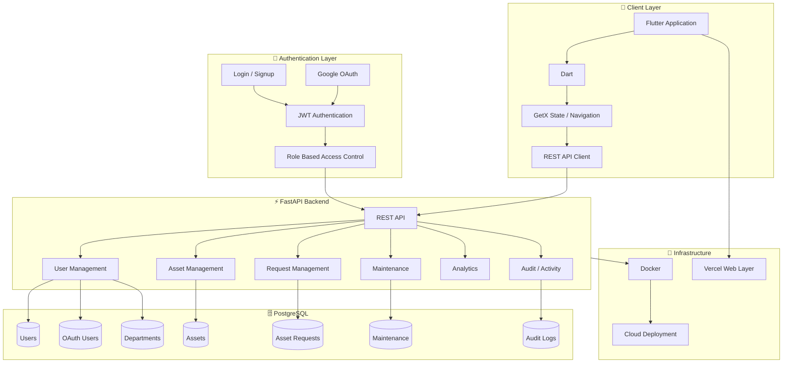

# 🏢 Orgaflow — Enterprise Asset & Resource Management Platform

[](https://flutter.dev/)
[](https://dart.dev/)
[](https://fastapi.tiangolo.com/)
[](https://www.postgresql.org/)
[](https://jwt.io/)
[](https://developers.google.com/identity)
[](https://www.docker.com/)
[](#)
[](https://vercel.com/)
[](https://github.com/)
[](#)

> **Orgaflow** is a full-stack Enterprise Asset & Resource Management Platform designed to centralize organizational assets, employee requests, approvals, assignments, maintenance, departments, and operational workflows into one secure system.
>
> The platform combines a **Flutter + Dart frontend**, **FastAPI backend**, **PostgreSQL database**, **JWT authentication**, **Google OAuth**, **role-based access control**, and **Docker-based backend infrastructure** to provide a scalable foundation for modern organizational asset management.

---

## 📑 Table of Contents

* [Overview](#-overview)
* [Problem Statement](#-problem-statement)
* [Project Vision](#-project-vision)
* [MVP](#-mvp)
* [Key Features](#-key-features)
* [User Roles & RBAC](#-user-roles--rbac)
* [Employee Portal](#-employee-portal)
* [Asset Manager Portal](#-asset-manager-portal)
* [Department Head Portal](#-department-head-portal)
* [Admin Portal](#-admin-portal)
* [Asset Lifecycle](#-asset-lifecycle)
* [Request Management](#-request-management)
* [Maintenance Management](#-maintenance-management)
* [Authentication & Security](#-authentication--security)
* [Google OAuth](#-google-oauth)
* [JWT Authorization](#-jwt-authorization)
* [System Architecture](#-system-architecture)
* [Frontend Architecture](#-frontend-architecture)
* [Backend Architecture](#-backend-architecture)
* [Database Architecture](#-database-architecture)
* [REST API](#-rest-api)
* [Database Schema](#-database-schema)
* [Request Workflow](#-request-workflow)
* [Security Architecture](#-security-architecture)
* [Docker Architecture](#-docker-architecture)
* [Deployment Architecture](#-deployment-architecture)
* [Analytics & Reporting](#-analytics--reporting)
* [Notifications](#-notifications)
* [Project Structure](#-project-structure)
* [Technology Stack](#-technology-stack)
* [Development Status](#-development-status)
* [Roadmap](#-roadmap)
* [Future Enterprise Architecture](#-future-enterprise-architecture)
* [Developer](#-developer)
* [License](#-license)

---

# 🌐 Overview

Organizations manage hundreds or thousands of resources such as:

* Laptops
* Smartphones
* Tablets
* Cameras
* Projectors
* Displays
* Networking equipment
* UPS systems
* Office equipment
* Department resources
* Other organizational hardware

Traditional asset management often depends on:

```text
Spreadsheets
     +
Emails
     +
Manual Approvals
     +
Disconnected Records
     +
Manual Maintenance Tracking
```

This creates problems such as:

* Duplicate records
* Missing asset information
* Delayed approvals
* Poor visibility
* Difficult asset tracking
* Lack of accountability
* No centralized request workflow
* Difficult maintenance management

**Orgaflow** brings these workflows together into a centralized platform.

---

# 🎯 Problem Statement

The objective of Orgaflow is to create a centralized system where an organization can manage the complete lifecycle of its resources.

Instead of maintaining separate records for:

```text
Employees
Assets
Requests
Approvals
Departments
Maintenance
Assignments
History
```

Orgaflow provides a connected ecosystem:

```text
Employee
   ↓
Asset Request
   ↓
Manager Review
   ↓
Approval / Rejection
   ↓
Asset Assignment
   ↓
Asset Usage
   ↓
Maintenance
   ↓
Return / Transfer
   ↓
Asset Retirement
```

---

# 🚀 Project Vision

Orgaflow is designed to evolve from an asset-request application into a complete **Enterprise Resource & Asset Management Platform**.

The long-term vision is:

```text
                    ORGAFLOW
                       │
       ┌───────────────┼────────────────┐
       │               │                │
   Employees       Management          Admin
       │               │                │
       └───────────────┼────────────────┘
                       │
               Asset Management
                       │
             Request Management
                       │
              Asset Assignment
                       │
               Maintenance
                       │
                 Analytics
                       │
                  Audit Logs
```

---

# ⭐ MVP

The current MVP focuses on the complete employee asset-request workflow.

## Employee Workflow

```text
Employee Login
      ↓
Employee Dashboard
      ↓
Available Assets
      ↓
Asset Details
      ↓
Request Asset
      ↓
Request Stored in PostgreSQL
      ↓
Track Request
```

## Management Workflow

```text
Management Login
      ↓
Asset Management Dashboard
      ↓
Employee Requests
      ↓
Request Details
      ↓
Approve / Not Approve
      ↓
Database Update
      ↓
Employee Sees Updated Status
```

---

# ✨ Key Features

### 🔐 Authentication

* Email/password authentication
* Password hashing
* JWT-based authentication
* Google OAuth
* Active-user validation
* Role-aware login
* Secure API authorization

### 👥 User Management

* Employee accounts
* Management accounts
* Role-based permissions
* Department association
* Account status
* User profile management

### 📦 Asset Management

* Asset inventory
* Asset identification
* Asset categories
* Asset brand/model
* Asset availability
* Asset assignment
* Asset lifecycle tracking

### 📝 Request Management

* Employee asset requests
* Request priority
* Request descriptions
* Unique request codes
* Request status
* Manager approval
* Manager rejection
* Rejection reason
* Request history

### 🛠️ Maintenance

Designed for:

* Maintenance schedules
* Repair records
* Maintenance history
* Service records
* Maintenance status
* Maintenance costs

### 📊 Analytics

Designed to provide:

* Total assets
* Available assets
* Assigned assets
* Pending requests
* Approved requests
* Rejected requests
* Maintenance statistics
* Department-wise asset usage

---

# 👨‍💻 Employee Portal

The Employee Portal provides employees with a dedicated workspace.

## Employee Capabilities

Employees can:

* Register
* Login
* Login using Google
* View dashboard
* Browse available assets
* View asset details
* Submit asset requests
* Select request priority
* Add request description
* Track requests
* View request status
* View rejection reason
* View assigned assets
* Manage profile

### Employee Navigation

```text
┌─────────────────────────────┐
│       Employee Home         │
├─────────────────────────────┤
│                             │
│  Home                       │
│  Assets                     │
│  My Requests                │
│  My Assets                  │
│  Profile                    │
│                             │
└─────────────────────────────┘
```

---

# 🧑‍💼 Asset Manager Portal

Asset Managers are responsible for operational asset and request management.

## Capabilities

* View employee requests
* Search requests
* Filter requests
* View employee details
* View department
* View asset information
* View priority
* View request description
* Approve requests
* Reject requests
* Enter rejection reason
* Review request history
* Monitor request statistics
* Manage asset operations

### Manager Request Actions

```text
                Pending
                   │
          ┌────────┴────────┐
          ↓                 ↓
       Approve          Not Approve
          │                 │
          ↓                 ↓
      Approved       Rejection Reason
                            │
                            ↓
                      Not Approved
```

---

# 🏢 Department Head Portal

The Department Head role is designed for department-level management.

Potential responsibilities include:

* View department assets
* View department employees
* Review department requests
* Monitor department asset usage
* Approve department-level requirements
* Monitor asset availability
* Review department reports

Department Heads operate within their authorized organizational scope.

---

# 👑 Admin Portal

Administrators provide system-wide control.

Admin capabilities are designed to include:

* User management
* Role management
* Department management
* Asset management
* Request management
* System configuration
* Security monitoring
* Audit logs
* Organization-wide analytics

The backend remains responsible for enforcing administrative permissions.

---

# 🔐 User Roles & RBAC

Orgaflow uses **Role-Based Access Control (RBAC)**.

### Supported Roles

| Role            | Primary Responsibility      |
| --------------- | --------------------------- |
| Employee        | Request and track assets    |
| Asset Manager   | Manage assets and requests  |
| Department Head | Department-level management |
| Admin           | System-wide administration  |

---

## RBAC Architecture

```text
                    Authentication
                          │
                          ↓
                    JWT Validation
                          │
                          ↓
                    User Lookup
                          │
                          ↓
                    Database Role
                          │
             ┌────────────┼────────────┐
             ↓            ↓            ↓
         Employee      Manager       Admin
             │            │            │
             ↓            ↓            ↓
        Employee       Management    System
        Features       Features      Features
```

The frontend does not determine whether a user is an administrator.

The backend validates the user's actual role.

---

# 📦 Asset Lifecycle

Orgaflow is designed around the complete asset lifecycle.

```text
                    Asset Created
                         │
                         ↓
                     Available
                         │
                         ↓
                      Requested
                         │
                         ↓
                     Approved
                         │
                         ↓
                     Assigned
                         │
                         ↓
                      In Use
                         │
                 ┌───────┴───────┐
                 ↓               ↓
             Maintenance       Returned
                 │               │
                 ↓               ↓
             Available        Available
                                 │
                                 ↓
                              Retired
```

---

# 📝 Request Management

Each employee request contains structured information.

### Employee Information

```text
Employee Name
Employee Email
Department
User ID
```

### Asset Information

```text
Asset ID
Asset Name
Category
Brand
Model
```

### Request Information

```text
Request Code
Priority
Description
Status
Created Date
Updated Date
Review Date
Reviewer
Rejection Reason
```

---

# 🔄 Request Lifecycle

Every request begins as:

```text
Pending
```

Management can then process the request.

### Approved

```text
Pending → Approved
```

### Not Approved

```text
Pending → Not Approved
```

A rejection requires an explanation.

Example:

```text
Not Approved

Reason:
"The requested asset is currently unavailable."
```

The reason is persisted in PostgreSQL and can be viewed by the employee.

---

# 🛠️ Maintenance Management

The platform is designed to extend asset management into maintenance operations.

### Maintenance Features

* Maintenance scheduling
* Repair tracking
* Service history
* Maintenance status
* Service provider
* Maintenance cost
* Maintenance notes
* Asset downtime
* Maintenance completion

### Maintenance Lifecycle

```text
Maintenance Required
        ↓
Maintenance Scheduled
        ↓
Under Maintenance
        ↓
Repair Completed
        ↓
Quality Check
        ↓
Available
```

---

# 🔐 Authentication & Security

Security is implemented across multiple layers.

## Authentication

Orgaflow supports:

* Email/password authentication
* Password hashing
* JWT
* Google OAuth

## Authorization

Authorization includes:

* User role validation
* Portal validation
* Active account validation
* Protected API endpoints
* Management-only operations
* Employee-specific request access

---

# 🔑 Google OAuth

Google authentication is integrated into the authentication architecture.

```text
Google Sign-In
      ↓
Google Identity Token
      ↓
FastAPI Verification
      ↓
User Lookup
      ↓
Role Validation
      ↓
JWT Generation
      ↓
Authenticated Session
```

Google authentication does not automatically grant management privileges.

The user's authorized role is controlled by backend/database rules.

---

# 🎫 JWT Authorization

After successful authentication, the backend issues a JWT access token.

Conceptually:

```text
User Credentials
       ↓
Authentication
       ↓
JWT
       ↓
Flutter Client
       ↓
Authorization Header
       ↓
FastAPI
       ↓
JWT Verification
       ↓
User & Role Validation
       ↓
Protected Resource
```

Protected operations require a valid authenticated identity.

---

# 🛡️ Security Model

Orgaflow follows a **backend-first authorization model**.

For example:

```text
Employee
│
├── View Own Requests       ✅
├── Create Request          ✅
├── View All Requests       ❌
├── Approve Request         ❌
└── Reject Request          ❌
```

```text
Asset Manager
│
├── View Requests           ✅
├── Review Requests         ✅
├── Approve Request         ✅
├── Reject Request          ✅
└── Provide Rejection       ✅
```

This prevents security from depending only on hidden or disabled UI buttons.

---

# 🏗️ Full-Stack Architecture



---

# 📱 Frontend Architecture

The frontend is built using Flutter and Dart.

### Main Responsibilities

* UI rendering
* Navigation
* Form handling
* Authentication state
* API communication
* Request submission
* Request tracking
* Role-specific screens
* Error handling
* Loading states
* User feedback

### Frontend Flow

```text
Flutter UI
    ↓
User Action
    ↓
Validation
    ↓
HTTP REST Request
    ↓
FastAPI
    ↓
Response
    ↓
State Update
    ↓
UI Refresh
```

---

# ⚡ Backend Architecture

FastAPI acts as the central application layer.

### Backend Responsibilities

* Authentication
* Password verification
* JWT creation
* JWT validation
* Google token verification
* Role authorization
* Request validation
* Business logic
* PostgreSQL operations
* Asset operations
* Request processing
* Management operations

---

# 🗄️ Database Architecture

Primary database:

**PostgreSQL**

Database:

```text
orgaflow_db
```

The relational database is designed to maintain persistent organizational records.

---

# 📊 Database Schema

## Users

```text
users
│
├── id
├── name
├── email
├── password_hash
├── role
├── department_id
├── status
└── created_at
```

---

## OAuth Users

```text
oauth_users
│
├── user_id
├── google_id
├── email
├── name
├── portal
├── role
└── status
```

---

## Departments

Conceptually:

```text
departments
│
├── id
├── name
├── head_id
├── status
└── created_at
```

---

## Assets

The asset inventory is designed to contain:

```text
assets
│
├── id
├── asset_code
├── name
├── category
├── brand
├── model
├── serial_number
├── status
├── department_id
├── assigned_user_id
├── location
├── purchase_date
├── warranty_end
├── image
├── created_at
└── updated_at
```

---

## Asset Requests

```text
asset_requests
│
├── id
├── request_code
├── user_id
├── employee_name
├── employee_email
├── department
├── asset_id
├── asset_name
├── asset_category
├── asset_brand
├── asset_model
├── priority
├── description
├── status
├── rejection_reason
├── created_at
├── updated_at
├── reviewed_at
└── reviewed_by
```

---

## Maintenance

Designed structure:

```text
maintenance_records
│
├── id
├── asset_id
├── issue
├── description
├── priority
├── status
├── assigned_to
├── cost
├── scheduled_date
├── completed_date
├── notes
└── created_at
```

---

## Audit Logs

For future enterprise auditing:

```text
audit_logs
│
├── id
├── user_id
├── action
├── entity_type
├── entity_id
├── description
├── timestamp
└── metadata
```

---

# 🔗 Entity Relationships

```text
                    Department
                        │
              ┌─────────┴─────────┐
              ↓                   ↓
            Users              Assets
              │                   │
              │                   │
              └────────┬──────────┘
                       ↓
                  Asset Requests
                       │
                       ↓
                  Review / Approval
                       │
             ┌─────────┴─────────┐
             ↓                   ↓
         Approved           Not Approved
             │                   │
             ↓                   ↓
      Asset Assignment     Rejection Reason
```

---

# 📡 REST API Architecture

Orgaflow uses RESTful APIs between the Flutter frontend and FastAPI backend.

## Authentication APIs

```text
POST /api/auth/signup
POST /api/auth/login
POST /api/auth/google-login
```

## Request APIs

```text
POST   /api/requests
GET    /api/requests
GET    /api/requests/my
GET    /api/requests/{request_id}
PATCH  /api/requests/{request_id}/status
GET    /api/requests/stats
```

## Health / System APIs

```text
GET /api/health
```

Additional asset, maintenance, analytics, and administration endpoints can be added as the platform expands.

---

# 📥 Request Creation API

Example request payload:

```json
{
  "asset_id": "AST-1001",
  "asset_name": "Dell Latitude 5420",
  "asset_category": "Laptop",
  "asset_brand": "Dell",
  "asset_model": "Latitude 5420",
  "department": "IT",
  "priority": "Normal",
  "description": "Laptop required for development work."
}
```

### Processing

```text
Request
   ↓
JWT Validation
   ↓
User Validation
   ↓
Role Validation
   ↓
Input Validation
   ↓
PostgreSQL Insert
   ↓
Request Code
   ↓
API Response
```

---

# ✅ Approval API

Management can approve a pending request.

```json
{
  "status": "Approved",
  "rejection_reason": null
}
```

The status is persisted in PostgreSQL.

---

# ❌ Rejection API

Rejection requires a reason.

```json
{
  "status": "Rejected",
  "rejection_reason": "The requested asset is currently unavailable."
}
```

The rejection reason is stored with the request.

The employee can see it through the Track Requests module.

---

# 🔍 Request Visibility

Orgaflow follows user-specific data access.

### Employee

```text
GET /api/requests/my
```

returns the authenticated employee's requests.

### Management

```text
GET /api/requests
```

provides management-level request visibility according to backend authorization.

This prevents employees from accessing other employees' requests through the client application.

---

# 🐳 Docker Architecture

Docker is used as part of the backend infrastructure and deployment strategy.

Conceptual architecture:

```text
             Docker Environment
                    │
          ┌─────────┴─────────┐
          │                   │
     FastAPI App         PostgreSQL
       Container            Database
          │                   │
          └─────────┬─────────┘
                    │
                 REST API
                    │
                 Flutter
```

### Benefits

* Reproducible environment
* Consistent dependencies
* Easier deployment
* Environment isolation
* Simplified backend setup
* Scalable infrastructure

---

# ☁️ Deployment Architecture

Orgaflow is designed for cloud deployment.

A production-oriented architecture can use:

```text
                    Users
                      │
                      ↓
               Flutter / Web
                      │
                      ↓
                  Vercel
               Web Frontend
                      │
                      ↓
                REST API
                      │
                      ↓
               FastAPI Backend
                      │
                 Dockerized
                      │
                      ↓
               Cloud Backend
                      │
                      ↓
                PostgreSQL
```

### Deployment Components

| Layer              | Technology               |
| ------------------ | ------------------------ |
| Mobile App         | Flutter                  |
| Web Frontend       | Flutter Web / Vercel     |
| Backend            | FastAPI                  |
| Backend Container  | Docker                   |
| Database           | PostgreSQL               |
| Authentication     | JWT                      |
| Social Login       | Google OAuth             |
| Source Control     | GitHub                   |
| Web Deployment     | Vercel                   |
| Backend Deployment | Cloud container platform |

The architecture keeps the frontend, backend, authentication, and database layers independently deployable.

---

# 📊 Analytics & Reporting

Orgaflow is designed to provide management-level analytics.

### Asset Analytics

* Total assets
* Available assets
* Assigned assets
* Under-maintenance assets
* Retired assets
* Department-wise assets

### Request Analytics

* Total requests
* Pending requests
* Approved requests
* Not Approved requests
* Approval rate
* Department-wise requests
* Priority distribution

### Maintenance Analytics

* Open maintenance cases
* Completed maintenance
* Maintenance costs
* Asset downtime
* Frequently repaired assets

---

# 🔔 Notification Architecture

The platform can be extended with event-driven notifications.

Example:

```text
Employee Creates Request
        ↓
Request Created
        ↓
Notification Event
        ↓
Asset Manager
        ↓
Review Request
        ↓
Decision
        ↓
Employee Notification
```

Future notification channels:

* Push notifications
* Email
* In-app notifications
* Administrative alerts

---

# 📜 Audit & Accountability

Enterprise asset management requires accountability.

Orgaflow is designed to maintain audit information such as:

```text
Who performed the action?
What action was performed?
Which asset/request was affected?
When was the action performed?
What was the previous state?
What is the new state?
```

Example:

```text
User: Asset Manager
Action: REQUEST_APPROVED
Request: REQ-1001
Time: 2026-10-04
```

This provides the foundation for enterprise audit trails.

---

# 🧠 Business Logic

Important business rules are enforced by the backend.

Examples:

### Request Creation

```text
Authenticated User
        ↓
Valid User
        ↓
Allowed Role
        ↓
Valid Asset Request
        ↓
Create Pending Request
```

### Approval

```text
Pending Request
       ↓
Authorized Manager
       ↓
Approve
       ↓
Approved
```

### Rejection

```text
Pending Request
       ↓
Authorized Manager
       ↓
Rejection Reason Required
       ↓
Not Approved
```

A previously processed request should not be arbitrarily modified by unauthorized users.

---

# 🖥️ UI Modules

## Employee

1. Login
2. Signup
3. Employee Home
4. Available Assets
5. Asset Details
6. Request Asset
7. Track Requests
8. My Assets
9. Profile

## Asset Manager

1. Management Login
2. Dashboard
3. Asset Management
4. Employee Requests
5. Request Details
6. Approval Workflow
7. History
8. Maintenance

## Department Head

1. Department Dashboard
2. Department Assets
3. Department Requests
4. Department Employees
5. Department Analytics

## Admin

1. Admin Dashboard
2. User Management
3. Role Management
4. Department Management
5. Asset Management
6. Request Management
7. System Analytics
8. Audit Logs

---

# 🎨 UI/UX Design

Orgaflow follows a modern enterprise dashboard approach.

### Design Principles

* Clean interface
* Professional dashboard
* Consistent navigation
* Role-specific UI
* Clear status indicators
* Structured information cards
* Minimal visual clutter
* Mobile-friendly design
* Action-oriented workflows

### Design Direction

```text
Modern
Professional
Clean
Enterprise
Scalable
Mobile-Friendly
```

---

# 📂 Project Structure

```text
orgaflow_app/
│
├── lib/
│   │
│   ├── employee/
│   │   ├── existing_employee_home.dart
│   │   ├── employee_assets_page.dart
│   │   ├── employee_my_assets_page.dart
│   │   ├── employee_track_requests_page.dart
│   │   ├── employee_profile_page.dart
│   │   └── my_request.dart
│   │
│   ├── asset_manager/
│   │   ├── asset_manager_dashboard.dart
│   │   ├── asset_manager_request.dart
│   │   ├── asset_manager_maintenance.dart
│   │   └── asset_manager_history.dart
│   │
│   ├── auth/
│   │   └── login_screen.dart
│   │
│   └── main.dart
│
├── orgaflow_backend/
│   │
│   ├── main.py
│   ├── requirements.txt
│   ├── Dockerfile
│   └── ...
│
├── assets/
│
├── android/
│
├── pubspec.yaml
├── pubspec.lock
├── README.md
└── .gitignore
```

---

# 🧰 Technology Stack

## Frontend

* Flutter 3.35.3
* Dart 3.9.2
* Material UI
* GetX
* REST API integration
* SharedPreferences

## Backend

* Python
* FastAPI
* Uvicorn
* Pydantic
* REST APIs
* Passlib
* bcrypt
* JWT
* Google OAuth verification

## Database

* PostgreSQL
* SQL
* Relational database architecture

## DevOps

* Docker
* Git
* GitHub
* Environment variables
* Cloud deployment architecture

## Deployment

* Vercel for web frontend deployment
* Container-based backend deployment
* PostgreSQL cloud database

---

# 📌 Development Principles

Orgaflow follows several engineering principles:

### Separation of Concerns

```text
UI
 ↓
API Client
 ↓
Backend
 ↓
Business Logic
 ↓
Database
```

### Backend-First Security

Authorization is enforced at the backend rather than relying only on frontend restrictions.

### Persistent Data

Important application data is stored in PostgreSQL instead of depending on temporary UI state.

### Modular Architecture

Features are separated into individual modules and screens instead of placing the entire application inside a single file.

### API-Driven Architecture

The Flutter frontend communicates with the backend through REST APIs.

---

# 📈 Development Status

| Feature                       | Status |
| ----------------------------- | ------ |
| Flutter Application           | ✅      |
| Dart Application              | ✅      |
| Employee Portal               | ✅      |
| Authentication UI             | ✅      |
| Email/Password Authentication | ✅      |
| Password Hashing              | ✅      |
| JWT Authentication            | ✅      |
| Google OAuth                  | ✅      |
| PostgreSQL Integration        | ✅      |
| FastAPI Backend               | ✅      |
| REST API Layer                | ✅      |
| Employee Asset Requests       | ✅      |
| Persistent Request Storage    | ✅      |
| Employee Request Tracking     | ✅      |
| Asset Manager Requests        | ✅      |
| Request Approval              | ✅      |
| Request Rejection             | ✅      |
| Rejection Reason              | ✅      |
| Backend Role Authorization    | ✅      |
| Docker Infrastructure         | 🚧     |
| Complete Asset Inventory      | 🚧     |
| Advanced Asset Assignment     | 🚧     |
| Maintenance Management        | 🚧     |
| Department Analytics          | 🚧     |
| Audit Logs                    | 🚧     |
| Notification System           | 🚧     |
| Advanced Reporting            | 🚧     |
| Production Cloud Deployment   | 🚧     |

---

# 🗺️ Roadmap

## Phase 1 — Core MVP

* [x] Authentication
* [x] Employee portal
* [x] Google OAuth
* [x] JWT
* [x] PostgreSQL
* [x] FastAPI
* [x] Asset browsing
* [x] Asset requests
* [x] Request persistence
* [x] Request tracking
* [x] Manager approval
* [x] Manager rejection
* [x] Rejection reason
* [x] RBAC

---

## Phase 2 — Complete Asset Operations

* [ ] Asset inventory CRUD
* [ ] Asset assignment
* [ ] Asset return
* [ ] Asset transfer
* [ ] Asset replacement
* [ ] Asset retirement
* [ ] Serial number tracking
* [ ] Warranty tracking
* [ ] Location tracking

---

## Phase 3 — Maintenance

* [ ] Maintenance tickets
* [ ] Repair workflow
* [ ] Maintenance schedules
* [ ] Service records
* [ ] Maintenance cost tracking
* [ ] Asset downtime
* [ ] Maintenance history

---

## Phase 4 — Analytics

* [ ] Executive dashboard
* [ ] Asset utilization
* [ ] Department analytics
* [ ] Request analytics
* [ ] Maintenance analytics
* [ ] Cost analytics
* [ ] Advanced charts
* [ ] Exportable reports

---

## Phase 5 — Enterprise

* [ ] Audit logs
* [ ] Notification engine
* [ ] Email notifications
* [ ] Push notifications
* [ ] Advanced permission system
* [ ] Multi-organization support
* [ ] Organization isolation
* [ ] Backup and recovery
* [ ] Advanced security monitoring

---

# 🏢 Future Enterprise Architecture

The long-term platform can evolve toward a multi-organization architecture.

```text
                       ORGAFLOW
                           │
                ┌──────────┴──────────┐
                │                     │
          Organization A        Organization B
                │                     │
        ┌───────┼───────┐     ┌──────┼──────┐
        │       │       │     │      │       │
     Users   Assets  Requests Users Assets Requests
        │       │       │     │      │       │
        └───────┼───────┘     └──────┼──────┘
                │                     │
                └──────────┬──────────┘
                           │
                     Core Platform
                           │
             ┌─────────────┼─────────────┐
             │             │             │
           Auth         Analytics      Audit
             │             │             │
             └─────────────┼─────────────┘
                           │
                       PostgreSQL
```

This architecture could allow Orgaflow to support multiple organizations while maintaining logical separation between their users, assets, departments, and requests.

---

# 📊 Example Asset Inventory

| Asset                   | Category        | Example Status |
| ----------------------- | --------------- | -------------- |
| Dell Latitude 5420      | Laptop          | Available      |
| Samsung Galaxy A55      | Mobile          | Assigned       |
| DSLR Camera             | Camera          | Available      |
| Tripod                  | Equipment       | Available      |
| Projector               | Display         | Maintenance    |
| Conference Room Display | Display         | Assigned       |
| UPS                     | Power Equipment | Available      |
| Wi-Fi Router            | Networking      | Assigned       |

---

# 🔄 Complete Platform Lifecycle

```text
                    ┌──────────────┐
                    │    Admin     │
                    └──────┬───────┘
                           │
                    Create Organization
                           │
                           ↓
                    Create Departments
                           │
                           ↓
                     Add Employees
                           │
                           ↓
                      Add Assets
                           │
                           ↓
                    Asset Available
                           │
                           ↓
                    Employee Request
                           │
                           ↓
                    Manager Review
                           │
                 ┌─────────┴─────────┐
                 ↓                   ↓
             Approved            Rejected
                 │                   │
                 ↓                   ↓
          Asset Assignment     Rejection Reason
                 │
                 ↓
              In Use
                 │
                 ↓
             Maintenance
                 │
                 ↓
              Returned
                 │
                 ↓
              Available
                 │
                 ↓
               Retired
```

---

# 💡 Why Orgaflow?

Orgaflow is more than a simple asset listing application.

It combines:

```text
Authentication
      +
Role-Based Access
      +
Employee Management
      +
Asset Inventory
      +
Asset Requests
      +
Approval Workflow
      +
Asset Assignment
      +
Maintenance
      +
Analytics
      +
Auditability
```

The objective is to build a complete digital platform for organizational resource management.

---

# 🏆 Project Highlights

* Full-stack Flutter + FastAPI architecture
* Modern Flutter mobile/web application
* PostgreSQL relational database
* JWT authentication
* Google OAuth integration
* Backend-enforced RBAC
* Employee-specific request access
* Manager approval workflow
* Mandatory rejection reason
* Persistent request data
* Modular application structure
* RESTful backend architecture
* Docker-ready backend infrastructure
* Cloud deployment architecture
* Scalable database foundation
* Enterprise-oriented asset lifecycle
* Future maintenance and analytics modules

---

# 🧪 Engineering Focus

Orgaflow is being developed with emphasis on:

```text
Scalability
Security
Maintainability
Modularity
Database Integrity
API Design
Role-Based Authorization
User Experience
Cloud Deployment
```

---

# 👨‍💻 Developer

## Sumit Singh

**BCA Student | Flutter Developer | Full-Stack Developer**

### Technical Skills Used

```text
Flutter
Dart
Python
FastAPI
PostgreSQL
REST APIs
JWT
Google OAuth
Docker
Git
GitHub
```

---

# 📌 Project Information

| Property              | Details                                |
| --------------------- | -------------------------------------- |
| Project Name          | Orgaflow                               |
| Type                  | Full-Stack Application                 |
| Category              | Enterprise Asset & Resource Management |
| Frontend              | Flutter                                |
| Language              | Dart                                   |
| Backend               | FastAPI                                |
| Backend Language      | Python                                 |
| Database              | PostgreSQL                             |
| Authentication        | JWT + Google OAuth                     |
| Authorization         | Role-Based Access Control              |
| API                   | REST                                   |
| Containerization      | Docker                                 |
| Version Control       | Git / GitHub                           |
| Web Deployment Target | Vercel                                 |
| Backend Deployment    | Cloud Container Platform               |
| Development Status    | Active Development                     |

---

# 🤝 Contributing

Orgaflow is currently under active development.

Contributions, suggestions, bug reports, architecture improvements, and feature ideas are welcome.

### Contribution Flow

```text
Fork Repository
      ↓
Create Feature Branch
      ↓
Implement Feature
      ↓
Test Changes
      ↓
Commit
      ↓
Push
      ↓
Pull Request
```

---

# 📄 License

This project is currently developed as a student and portfolio project.

License information can be updated when Orgaflow is officially released as an open-source or commercial product.

---

# 🚀 Orgaflow

### Manage Assets. Automate Requests. Empower Organizations.

**Built with Flutter, Dart, FastAPI, PostgreSQL, JWT, Google OAuth and Docker.**
